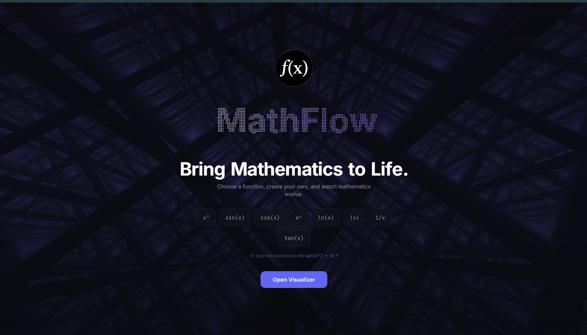
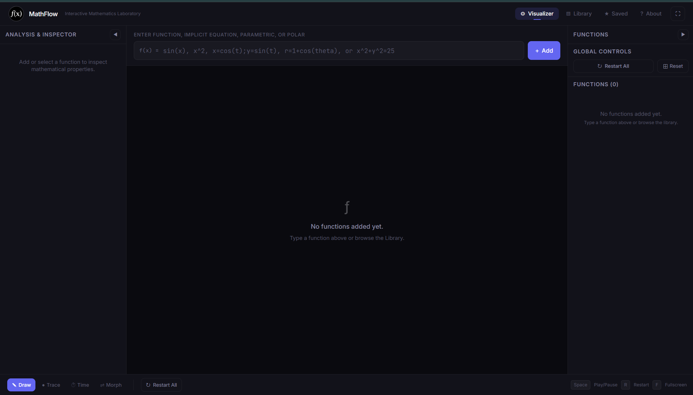
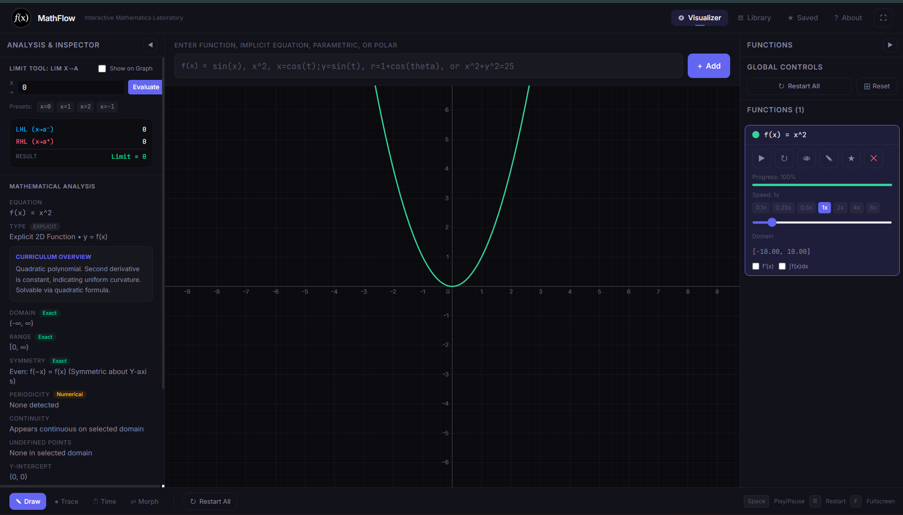
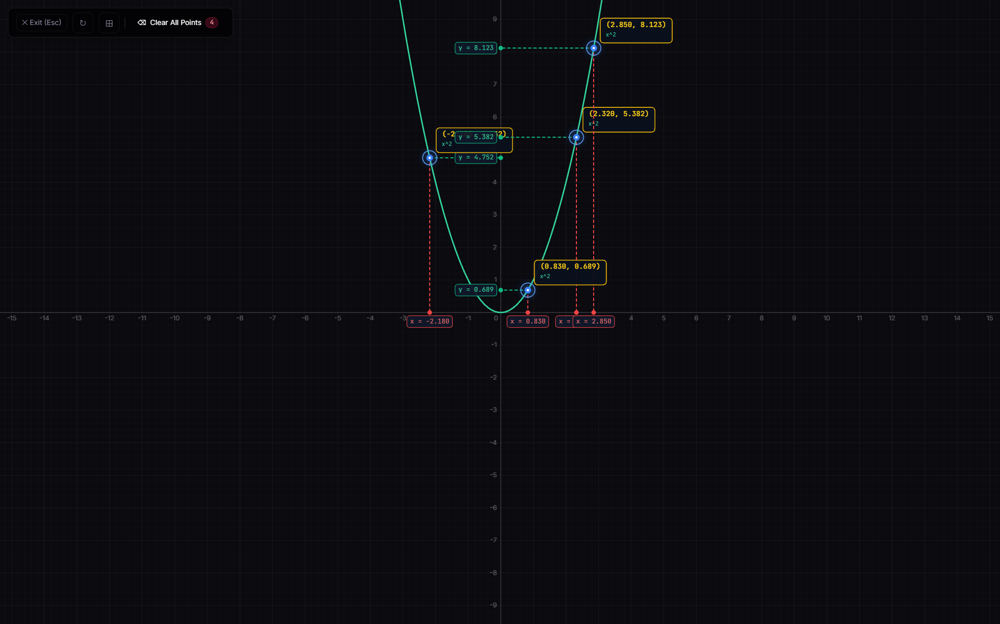
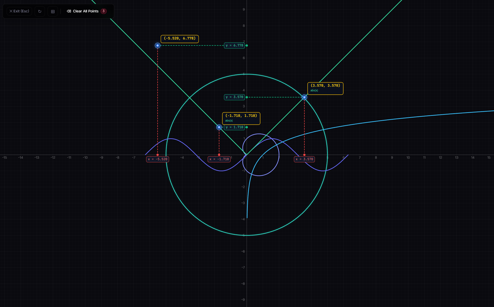

<div align="center">

# MathFlow

### Interactive Mathematics Laboratory

Explore functions, visualize curves, and inspect mathematical behaviour through an interactive graphing workspace.

<p>
  
</p>

<p>
  <a href="#features">Features</a> ·
  <a href="#screenshots">Screenshots</a> ·
  <a href="#getting-started">Get started</a> ·
  <a href="#usage">Usage</a>
</p>

</div>

---

## Contents

- [About](#about)
- [Features](#features)
- [Screenshots](#screenshots)
- [Technology](#technology)
- [Getting Started](#getting-started)
- [Usage](#usage)
- [Available Scripts](#available-scripts)
- [Project Structure](#project-structure)
- [Security and Configuration](#security-and-configuration)
- [Roadmap](#roadmap)
- [Contributing](#contributing)
- [License](#license)

## About

**MathFlow** is an interactive mathematics visualization project for exploring functions and calculus concepts in a graph-based workspace. Its dark interface keeps the focus on equations, curves, coordinates, and analysis tools.

The project includes a canvas-based graphing experience, mathematical expression input, function controls, and interactive point inspection. The screenshots in this README are captured from the project interface.

## Features

- **Interactive function plotting** for supported explicit, implicit, parametric, and polar expressions.
- **Multi-point coordinate highlighting:** click within the graph to place multiple coordinate markers, including locations on or away from curves.
- **Axis guides:** red vertical guides to the X-axis and green horizontal guides to the Y-axis, with blue point markers and yellow coordinate labels.
- **Point controls:** click an existing point to remove it, or use **Clear All Points** to remove all selected points at once. The clear button is shown only while selected points exist.
- **Calculus inspection tools** for supported operations such as limits, numerical derivatives, and definite integrals.
- **Graph navigation** with supported pan, zoom, and fullscreen controls.
- **Animation modes** for supported curve drawing, tracing, time-based evolution, or morphing.
- **Function library** for quickly exploring built-in examples.
- **Responsive dark interface** designed around the graph workspace.

> Feature availability and supported expression formats depend on the current implementation. Check the application UI and source code for the definitive list.

## Screenshots

<details open>
<summary><strong>1. Landing page</strong></summary>
<br>

The MathFlow landing page and function shortcuts.


</details>

<details>
<summary><strong>2. Visualizer before adding a function</strong></summary>
<br>

The graph workspace with the expression input and function controls.


</details>

<details>
<summary><strong>3. Graph with mathematical analysis</strong></summary>
<br>

A plotted parabola alongside the analysis panel.


</details>

<details>
<summary><strong>4. Multi-point highlighting on a curve</strong></summary>
<br>

Multiple selected points with coordinate labels and axis guides.


</details>

<details>
<summary><strong>5. Multiple functions and selected points</strong></summary>
<br>

Point highlighting with several curves in the same graph view.


</details>

## Technology

The project README supplied for this repository identifies the following stack. Confirm package versions against `package.json` before publishing any version-specific claims.

- **UI:** React
- **Language:** TypeScript
- **Build tool:** Vite
- **Styling:** Tailwind CSS
- **Math evaluation:** Math.js
- **Rendering:** HTML Canvas 2D API
- **Animation:** Existing project animation system and browser rendering APIs

## Getting Started

### Prerequisites

Install a supported version of [Node.js](https://nodejs.org/) and npm. Use the version required by the project's `package.json` and lockfile.

### 1. Clone the repository

```bash
git clone https://github.com/shivamgadakh-1907/math-flow.git
cd math-flow
```

### 2. Install dependencies

```bash
npm install
```

### 3. Configure environment variables

If the project uses environment variables, copy the example file and fill in only the values required for local development:

```bash
cp .env.example .env
```

On Windows PowerShell, you can use:

```powershell
Copy-Item .env.example .env
```

If the project does not require environment variables, this step can be skipped. Never commit real credentials or secrets.

### 4. Start the development server

```bash
npm run dev
```

Open the local URL printed in the terminal. Vite commonly uses `http://localhost:5173`, but use the URL shown by your own terminal.

## Usage

1. Open the visualizer.
2. Enter a supported mathematical expression in the function input.
3. Select **Add** to plot it.
4. Click inside the graph to place coordinate markers.
5. Select multiple locations to compare their coordinates and axis guides.
6. Click a selected point again to remove that point, or use **Clear All Points** to clear the full selection.
7. Use the graph's available pan, zoom, animation, and analysis controls to explore the result.

Examples to try, if supported by the current expression parser:

```text
x^2
sin(x)
cos(x)
exp(x)
ln(x)
abs(x)
1/x
x^2 + y^2 = 25
```

Expression syntax can vary by graph type; use the examples and validation messages provided by the application.

## Available Scripts

Run `npm run` to see the scripts configured in the current project. Common Vite scripts may include:

```bash
npm run dev
npm run build
npm run preview
```

Run only scripts that exist in `package.json`. If a lint or test script is configured, run it before submitting changes.

## Project Structure

The exact structure may evolve. A typical layout for this project can include:

```text
math-flow/
├── public/                 # Public assets
├── docs/
│   └── screenshots/        # README screenshots
├── src/
│   ├── components/         # Interface components
│   ├── graph/              # Graph rendering and interactions
│   ├── hooks/              # Shared state and hooks
│   ├── math/               # Expression and analysis logic
│   ├── App.tsx
│   ├── index.css
│   ├── main.tsx
│   └── types.ts
├── .env.example
├── .gitignore
├── index.html
├── package.json
└── README.md
```

Treat this as an illustrative map, not a guarantee. Update it to match the repository's real files before release.

## Security and Configuration

- Keep secrets in local environment files or a suitable secret manager; do not commit them.
- Validate mathematical input using the project's controlled expression parser. Do not execute arbitrary user input as JavaScript.
- Review dependency alerts and test changes before deployment.
- Avoid publishing private user data, local machine paths, or credentials in issues, screenshots, and logs.

## Roadmap

Potential future improvements, only if they fit the project goals:

- Exporting graphs as image files.
- Improved equation formatting and accessibility.
- Additional graph interaction and analysis tools.
- More automated tests for mathematical edge cases and animation behaviour.

These are ideas for future work, not claims that the features are already implemented.

## Contributing

Contributions and bug reports are welcome.

1. Open an issue describing the problem or proposed change.
2. Create a focused branch for your change.
3. Keep changes small and test relevant graph interactions.
4. Run the available build, lint, and test scripts.
5. Open a pull request with a clear summary and screenshots for UI changes.

## License

This project is licensed under the [MIT License](LICENSE).
