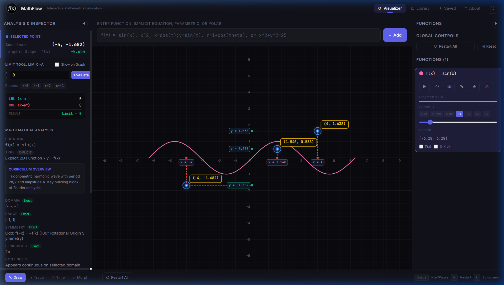

# MathFlow

> **Interactive Mathematics Visualizer** — A high-performance, canvas-based graphing and calculus platform built with React 19, TypeScript, and Math.js.



---

## Overview

**MathFlow** is an interactive mathematical visualization application designed for exploring functions, curves, and calculus concepts in real time. Built with a custom HTML5 Canvas 2D rendering pipeline and powered by Math.js, MathFlow renders explicit Cartesian functions, implicit relations, parametric curves, and polar equations with high precision and smooth animations.

MathFlow combines mathematical rigor with a sleek, dark-slate visual identity, featuring interactive multi-point coordinate highlighting, real-time numerical derivatives and tangent slopes, definite integrals with geometric area shading, and one-sided/two-sided limit evaluations.

---

## Key Features

- **Multi-Type Function Plotting**:
  - **Explicit Cartesian**: $y = f(x)$ with automatic asymptote and discontinuity handling (e.g., $\tan(x)$, $1/(x-2)$).
  - **Implicit Relations**: $f(x, y) = c$ rendered via segment marching (e.g., circles, astroids, heart curves).
  - **Parametric Curves**: $x = x(t), y = y(t)$ with configurable parameter bounds $t \in [a, b]$.
  - **Polar Curves**: $r = r(\theta)$ with angular sweep $\theta \in [0, 2\pi]$.
- **Interactive Multi-Point Coordinate Highlighting**:
  - Click anywhere on or off curves to place persistent mathematical coordinate markers.
  - **Colored Axis Guides**:
    - **Red**: Vertical guide line connecting the point to the X-axis ($y = 0$).
    - **Green**: Horizontal guide line connecting the point to the Y-axis ($x = 0$).
    - **Blue**: High-contrast marker with glowing pulse indicator.
    - **Yellow**: Floating badge displaying formatted coordinates $(x, y)$ and curve names.
  - **Point Toggling**: Click existing points within a configurable hit radius to remove them independently.
  - **Clear All Points**: Dedicated control that dynamically appears when points exist and removes all markers and guides in a single operation.
- **Calculus & Analytical Tools**:
  - **Numerical Differentiation**: Tangent slope $f'(x)$ computed in real time at inspection points.
  - **Definite Integration**: Numerical integration over $[a, b]$ with visual geometric area fill.
  - **Limit Evaluation**: Left-hand ($\lim_{x \to a^-}$), right-hand ($\lim_{x \to a^+}$), and two-sided limits with existence validation.
  - **Critical Points**: Automatic detection of roots (X-intercepts), Y-intercepts, local minima, and local maxima.
- **Dynamic Animation & Time Evolution**:
  - **Draw Mode**: Progressive curve pen-draw animation.
  - **Trace Mode**: Dynamic particle tracing along the curve path.
  - **Time Evolution**: Functions containing variable $t$ (e.g., $\sin(x - t)$) evolve smoothly over time.
  - **Curve Morphing**: Smooth visual transitions between two distinct functions $f(x) \to g(x)$.
- **Curated Function Library**:
  - Over 30 pre-configured mathematical models ranging from standard polynomials and trigonometry to acoustic wave interference, damped harmonic oscillators, and classical curves.
- **Responsive Controls & Gesture Support**:
  - Smooth pan and zoom with mouse wheel, drag, or multi-touch pinch gestures on mobile devices.
  - Fullscreen immersion mode with on-canvas controls.

---

## Screenshots

| Landing Dashboard | Interactive Coordinate Highlighting |
| :---: | :---: |
|  |  |

---

## Technology Stack

- **UI Framework**: [React 19](https://react.dev/) (`react`, `react-dom`)
- **Language**: [TypeScript](https://www.typescriptlang.org/)
- **Build Tool**: [Vite 8](https://vitejs.dev/) with `@vitejs/plugin-react`
- **Styling**: [Tailwind CSS 4](https://tailwindcss.com/) (`@tailwindcss/vite`)
- **Mathematics Engine**: [Math.js](https://mathjs.org/) for mathematical parsing, compilation, and evaluation
- **Animation**: [Framer Motion](https://www.framer.com/motion/) & HTML5 Canvas 2D API
- **Typography**: Inter & JetBrains Mono

---

## Project Structure

```text
math-flow/
├── public/                 # Static assets, logos, and screenshots
│   ├── favicon.svg
│   ├── mathflow-logo.svg
│   └── screenshots/
├── src/
│   ├── components/         # UI components & views
│   │   ├── DashboardPage.tsx     # Landing page with particle hero
│   │   ├── FunctionInput.tsx     # Math input bar with type classification
│   │   ├── FunctionManager.tsx   # Right sidebar for active functions
│   │   ├── InfoPanel.tsx         # Left sidebar with calculus analysis
│   │   ├── LibraryPage.tsx       # Curated mathematical preset catalog
│   │   └── ParticleText.tsx      # Particle assembly text animation
│   ├── graph/
│   │   └── GraphCanvas.tsx       # High-performance 2D canvas rendering engine
│   ├── hooks/
│   │   └── useAppState.ts        # Central graph, view, and function state hook
│   ├── math/
│   │   ├── engine.ts             # Mathematical evaluation, limits, & derivatives
│   │   └── library.ts            # Pre-configured mathematical models catalog
│   ├── App.tsx                   # Main application layout and coordinator
│   ├── index.css                 # Global styles, color tokens, and Tailwind theme
│   ├── main.tsx                  # React DOM root entry point
│   └── types.ts                  # Shared TypeScript interfaces & types
├── .env.example            # Environment variable template
├── .gitignore              # Git ignore rules for node, dist, and local caches
├── index.html              # HTML document template
├── package.json            # Project dependencies and npm scripts
├── tsconfig.json           # TypeScript configuration
└── vite.config.ts          # Vite build configuration
```

---

## Installation & Setup

### Prerequisites

- [Node.js](https://nodejs.org/) (version 18 or higher recommended; Node 20+ tested)
- npm, yarn, or pnpm

### Getting Started

1. **Clone the repository:**
   ```bash
   git clone https://github.com/shivamgadakh-1907/math-flow.git
   cd math-flow
   ```

2. **Install dependencies:**
   ```bash
   npm install
   ```

3. **Configure Environment (Optional):**
   ```bash
   cp .env.example .env
   ```

4. **Start the local development server:**
   ```bash
   npm run dev
   ```
   Open [http://localhost:5173](http://localhost:5173) in your browser.

---

## Available Scripts

- `npm run dev`: Starts the Vite development server with Hot Module Replacement (HMR).
- `npm run build`: Type-checks with `tsc` and compiles the production bundle into `dist/`.
- `npm run preview`: Locally previews the production build output.

---

## Usage Guide

### 1. Plotting Expressions
Type a mathematical expression into the top input bar and press `Enter` or click **Add**:
- **Explicit**: `sin(x)`, `x^3 - 3*x`, `1 / (x^2 + 1)`, `exp(-x^2)`
- **Implicit**: `x^2 + y^2 = 25`, `(x^2 + y^2 - 1)^3 = x^2 * y^3`
- **Parametric**: `x = cos(t), y = sin(t)`
- **Polar**: `r = 1 + cos(theta)`
- **Time-dependent**: `sin(x - t) * cos(0.5 * t)`

### 2. Multi-Point Coordinate Highlighting
- Click anywhere on a plotted curve or in open graph space to place an interactive coordinate marker.
- Observe the **red vertical guide** to the X-axis and **green horizontal guide** to the Y-axis.
- The **yellow floating badge** displays exact mathematical $(x, y)$ coordinates.
- Click an existing marker to remove only that point.
- Click the **Clear All Points** button (top-left of the canvas or in the Analysis panel) to remove all markers simultaneously.

### 3. Calculus Inspection
- Select a plotted function and hover over or click a point on the curve.
- Open the **Analysis Panel** (left sidebar) to inspect the numerical tangent slope ($f'(x)$), calculate limits, or evaluate definite integrals.

---

## Current Limitations & Future Improvements

### Completed in Current Version:
- [x] High-performance HTML5 Canvas graphing for 2D, implicit, parametric, and polar curves.
- [x] Multi-point coordinate highlighting with colored axis guides and single-action clearing.
- [x] Numerical calculus inspection (derivatives, definite integrals, one/two-sided limits).
- [x] Smooth pan/zoom and responsive mobile touch gestures.
- [x] Presets catalog with 30+ categorized functions.

### Future Improvements:
- [ ] 3D surface graphing via WebGL/Three.js ($z = f(x, y)$).
- [ ] Export graph plots to SVG and high-resolution PNG images.
- [ ] LaTeX equation rendering in tooltips and function cards.
- [ ] Step-by-step symbolic differentiation and integration explanations.

---

## License

This project is open-source and available under the [MIT License](LICENSE).
